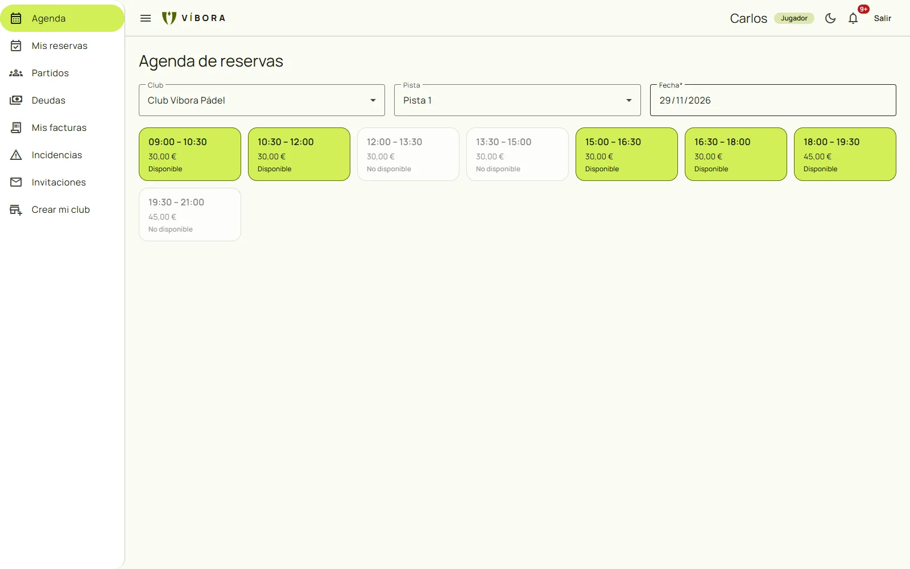
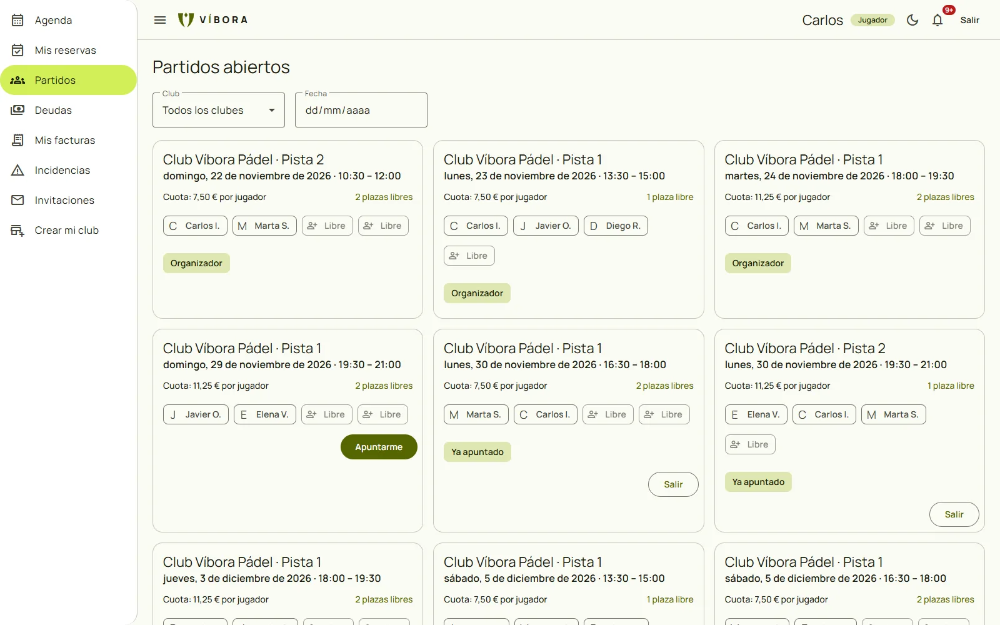
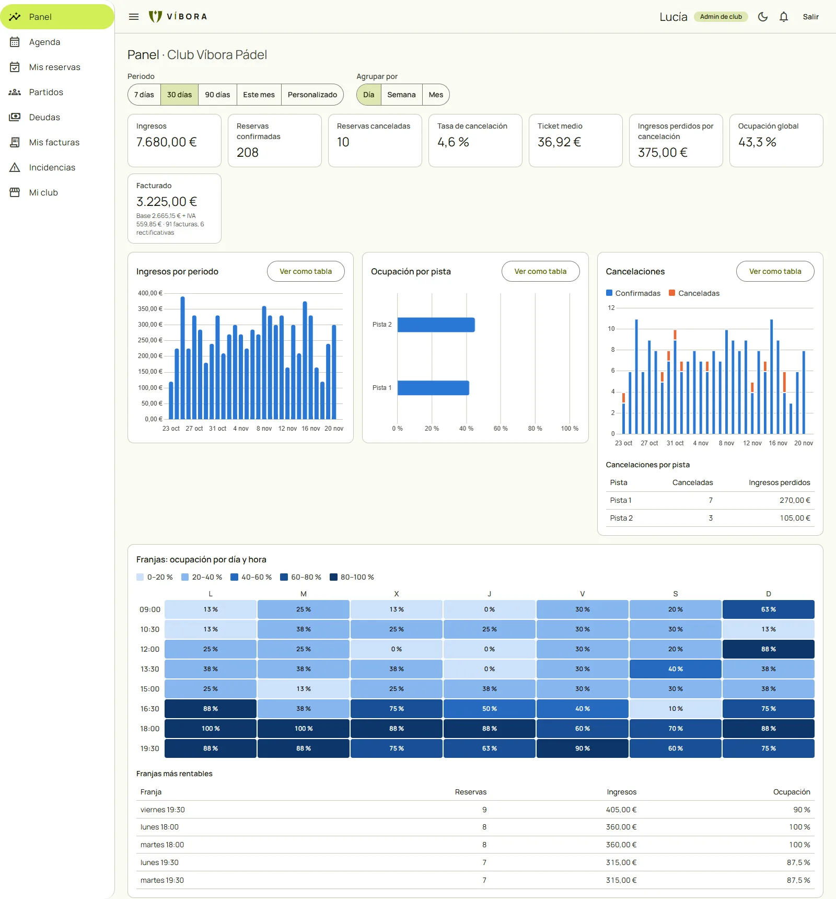
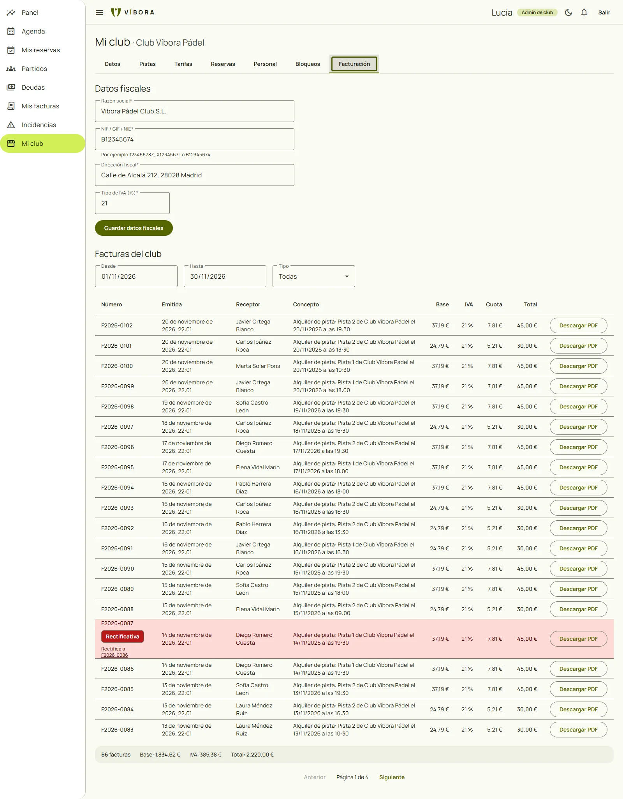
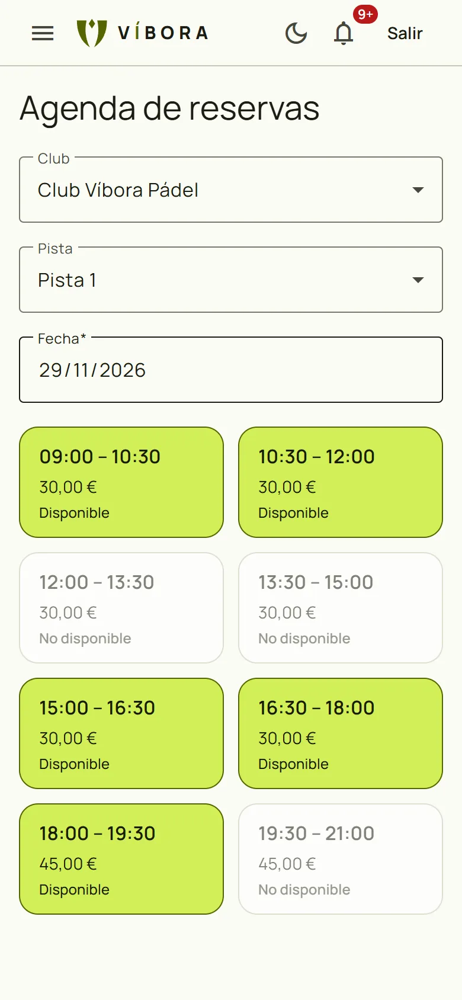
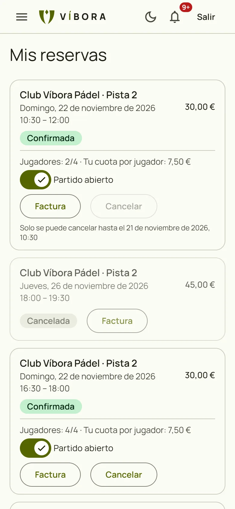
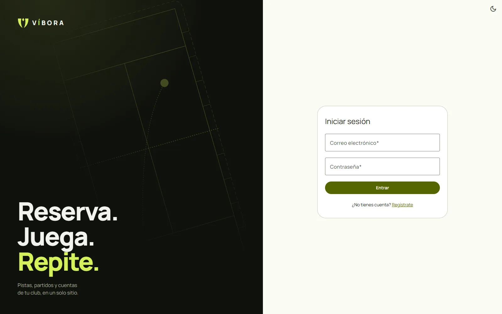
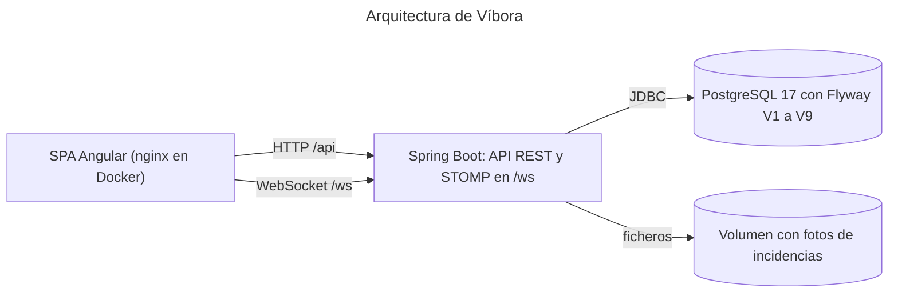
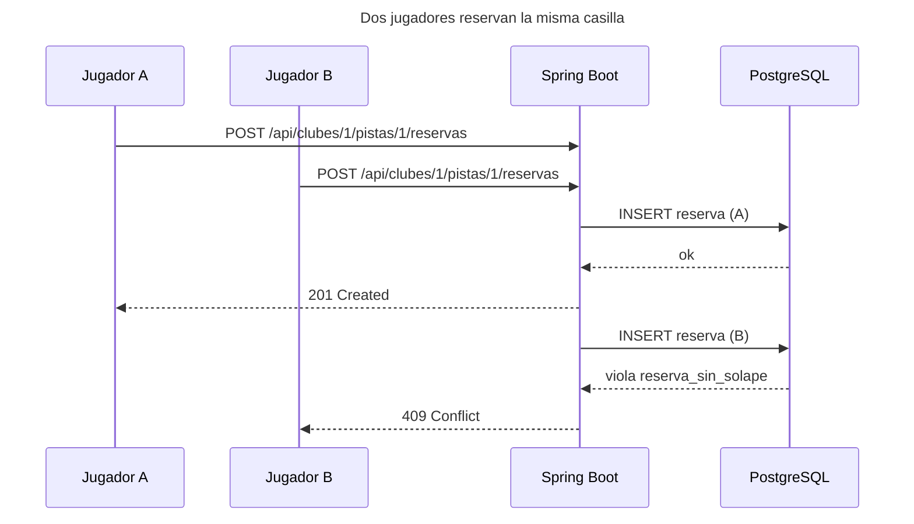

<a name="readme-top"></a>

<div align="center">

[English](./README.md) · **Español**

<picture>
  <source media="(prefers-color-scheme: dark)" srcset="./docs/assets/banner-dark.png">
  <source media="(prefers-color-scheme: light)" srcset="./docs/assets/banner-light.png">
  
</picture>

# Víbora

App para clubes de pádel que reserva pistas sin dobles reservas y ayuda a los jugadores a completar un partido y repartir la cuota.

<!-- Badges basados en el repo: el repositorio es privado, así que aún no se ven. Descomenta estas líneas cuando el repo sea público.
[](./LICENSE)
[](https://github.com/christianoller8/vibora/commits/main)
-->

**[Arquitectura](#arquitectura)** · [Seguridad](#seguridad) · [Puesta en marcha](#puesta-en-marcha) · [Pruebas y verificación](#pruebas-y-verificación) · [Estado y hoja de ruta](#estado-y-hoja-de-ruta)

</div>

> [!NOTE]
> Todos los datos son sintéticos: los usuarios son cuentas `@vibora.test` y todo el dinero es simulado. No hay pagos reales ni facturas reales.

## Demo

<!-- Vídeo de demo: aún no está grabado. Cuando exista, súbelo como se explica en las notas del autor, sustituye la URL de abajo y descomenta el bloque.
https://github.com/user-attachments/assets/00000000-0000-0000-0000-000000000000
-->

<table>
  <tr>
    <td width="50%">
      <picture>
        <source media="(prefers-color-scheme: dark)" srcset="./docs/assets/agenda-dark.webp">
        <source media="(prefers-color-scheme: light)" srcset="./docs/assets/agenda-light.webp">
        
      </picture>
    </td>
    <td width="50%">
      <picture>
        <source media="(prefers-color-scheme: dark)" srcset="./docs/assets/partidos-dark.webp">
        <source media="(prefers-color-scheme: light)" srcset="./docs/assets/partidos-light.webp">
        
      </picture>
    </td>
  </tr>
  <tr>
    <td width="50%">
      <picture>
        <source media="(prefers-color-scheme: dark)" srcset="./docs/assets/panel-dark.webp">
        <source media="(prefers-color-scheme: light)" srcset="./docs/assets/panel-light.webp">
        
      </picture>
    </td>
    <td width="50%">
      <picture>
        <source media="(prefers-color-scheme: dark)" srcset="./docs/assets/facturacion-dark.webp">
        <source media="(prefers-color-scheme: light)" srcset="./docs/assets/facturacion-light.webp">
        
      </picture>
    </td>
  </tr>
  <tr>
    <td width="50%">
      <picture>
        <source media="(prefers-color-scheme: dark)" srcset="./docs/assets/mobile-agenda-dark.webp">
        <source media="(prefers-color-scheme: light)" srcset="./docs/assets/mobile-agenda-light.webp">
        
      </picture>
      <picture>
        <source media="(prefers-color-scheme: dark)" srcset="./docs/assets/mobile-reservas-dark.webp">
        <source media="(prefers-color-scheme: light)" srcset="./docs/assets/mobile-reservas-light.webp">
        
      </picture>
    </td>
    <td width="50%">
      <picture>
        <source media="(prefers-color-scheme: dark)" srcset="./docs/assets/login-dark.webp">
        <source media="(prefers-color-scheme: light)" srcset="./docs/assets/login-light.webp">
        
      </picture>
    </td>
  </tr>
</table>

La interfaz tiene un tema oscuro (por defecto) y uno claro con un interruptor. El contraste se ha comprobado según WCAG AA en los dos.

## Sobre el proyecto

Muchos clubes pequeños de pádel gestionan las reservas por WhatsApp o en hojas de cálculo, y los jugadores pierden más tiempo buscando al cuarto y repartiendo el precio de la pista que jugando. Víbora da a cada club una agenda de pistas en la que **dos reservas nunca pueden solaparse**, y permite que un jugador abra su reserva como partido para que otros se apunten, con la cuota repartida automáticamente.

### Funcionalidades principales

- **Reservas sin solapes**: si dos jugadores reservan la misma casilla a la vez, uno recibe `201` y el otro `409`.
- **Partidos abiertos y cuotas compartidas**: hasta 4 jugadores por reserva; la cuota se reparte en céntimos y cada jugador recibe un cargo que pagar (pago simulado).
- **Avisos en vivo**: que alguien se apunte o salga, un cargo nuevo o una reserva cancelada llegan por WebSocket (STOMP) sin recargar.
- **Incidencias**: los jugadores que han jugado en el club y su personal reportan problemas de pista con fotos; el administrador las asigna a mantenimiento y puede bloquear una pista sin tocar las reservas ya hechas.
- **Gestión del club**: tarifas por franja, pistas, personal por invitación (la persona invitada acepta o rechaza) y reservas del día con cancelación del administrador.
- **Facturas**: numeración correlativa sin huecos por club y año, IVA, rectificativas y PDF. Son documentos simulados sin validez fiscal.
- **Panel de métricas**: ingresos, ocupación, mejores franjas y cancelaciones; es la pantalla de inicio del administrador del club (`/panel`).

### Alcance y no-objetivos

| Estado | Capacidad | Nota |
| --- | --- | --- |
| Hecho y probado | Reservas sin solapes bajo concurrencia | `ReservaConcurrenciaTests` |
| Hecho y probado | Tope de 10 reservas activas por jugador bajo concurrencia | `ReservaCupoConcurrenciaTests` |
| Hecho | Partidos abiertos, reparto de cuota y pagos simulados | Saldos por jugador |
| Hecho | Facturas, datos fiscales del club y panel de métricas | Pantallas en la pestaña "Facturación" del club, "Mis facturas" del jugador y `/panel` |
| Fuera de alcance | Pagos reales | El pago es un cambio de estado en la base de datos |
| Fuera de alcance | Facturas con validez fiscal | Todos los PDF dicen "documento simulado" |
| Fuera de alcance | Envío de correos | Las invitaciones y los avisos aparecen dentro de la app |
| Fuera de alcance | Varias instancias del backend | Los límites antiabuso viven en memoria de cada instancia |
| Fuera de alcance | App móvil nativa | La web es adaptable a móvil |
| Pendiente | Fase 4: emparejamiento con IA | Sin empezar |

## Arquitectura



La app Angular llama a la API REST y abre un WebSocket STOMP en `/ws`. En Docker, nginx sirve la app y reenvía `/api` y `/ws` al backend, que no se publica en el host. El backend guarda los datos en PostgreSQL, cuyo esquema gestionan las migraciones de Flyway `V1` a `V9`, y guarda las fotos de incidencias como ficheros en un volumen.

### Flujo de reserva



Las dos peticiones llegan a la vez. PostgreSQL acepta el primer insert y rechaza el segundo porque se solapa; el backend convierte esa violación en `409 Conflict`. La garantía vive en la base de datos, no en el código Java.

### Decisiones técnicas

| Decisión | Alternativa descartada | Por qué y qué cuesta |
| --- | --- | --- |
| "Sin reservas solapadas" es una restricción de exclusión de PostgreSQL (`btree_gist`, `reserva_sin_solape`) | Comprobar el solape en Java y luego insertar | Dos peticiones simultáneas no pueden pasar a la vez un comprobar-y-luego-insertar. Coste: la regla vive en SQL y hay que traducir la violación a un `409` (la comprobación en Java solo queda para dar un error amable en el caso normal) |
| Los permisos se leen de la base de datos en cada petición | Meter el rol del personal y el club en el JWT | Quien deja el personal del club pierde el acceso al instante, no cuando caduca el token. Coste: una consulta más por petición. El token solo lleva el email y un rol genérico en el que ningún endpoint confía |
| El número de factura sale de una fila contador bloqueada en la misma transacción (`factura_serie`) y un trigger hace inmutables las facturas | Calcular `max(numero) + 1`, o confiar en que la aplicación nunca edite | Si la transacción se deshace, el contador también, así que no hay huecos; una corrección es una factura rectificativa nueva. Coste: las facturas simultáneas de un mismo club y año se serializan |

### Roles y permisos

Todas las comprobaciones se hacen contra la base de datos, no contra el token.

| Rol | Qué puede hacer |
| --- | --- |
| `JUGADOR` | Reservar pistas, abrir y apuntarse a partidos, pagar su cuota, ver sus reservas, facturas y saldos; aceptar o rechazar invitaciones del personal. El auto-registro siempre crea este rol |
| `MONITOR` | Personal del club sin poderes de administración; puede reportar incidencias |
| `MANTENIMIENTO` | Trabaja las incidencias que le asignan y puede consultar los bloqueos de pista de su club |
| `ADMIN_CLUB` | Todo lo de su club: pistas, tarifas, invitaciones del personal, bloqueos de pista, reservas, facturas, datos fiscales y métricas |

### Definición de las métricas

Definidas en `vibora-backend/src/main/java/com/vibora/metricas/MetricasService.java`. El día de una reserva es la fecha local (Europe/Madrid) de su inicio, y de estos endpoints no sale ningún dato de jugadores.

| Métrica | Definición |
| --- | --- |
| Ingresos | Suma del precio congelado de las reservas `CONFIRMADA` por día de juego. No es lo cobrado ni lo facturado |
| Ingresos perdidos | La misma suma sobre las reservas canceladas |
| Ocupación | Casillas ocupadas entre casillas ofrecidas, con el horario y las pistas actuales para todo el rango |
| Tasa de cancelación | Reservas canceladas entre confirmadas más canceladas |
| Ticket medio | Ingresos entre reservas confirmadas (vacío si no hay ninguna) |
| Mejores franjas | Día de la semana y hora de inicio ordenados por ingresos y, a igualdad, por número de reservas |
| Facturado | Facturas emitidas en el rango, en neto de las rectificativas (que llevan importes negativos) |

<details>
<summary><strong>Endpoints principales</strong></summary>

Todo salvo el registro, el login, la renovación del token, el cierre de una sola sesión y `/actuator/health` necesita la cabecera `Authorization: Bearer <token>`.

| Método y ruta | Para qué sirve |
| --- | --- |
| `POST /api/auth/registro`, `POST /api/auth/login`, `GET /api/auth/me` | Registrarse, iniciar sesión, perfil actual |
| `POST /api/auth/refrescar`, `POST /api/auth/cerrar-sesion`, `POST /api/auth/cerrar-sesion-todas` | Rotar la cookie de refresco y obtener un token de acceso nuevo, cerrar esta sesión, cerrar la sesión en todas partes |
| `GET /api/clubes`, `POST /api/clubes`, `PUT /api/clubes/{id}` | Clubes |
| `GET\|POST /api/clubes/{clubId}/pistas`, `.../tarifas` | Pistas y tarifas |
| `GET /api/clubes/{clubId}/pistas/{pistaId}/agenda?fecha=` | Agenda diaria de una pista |
| `POST /api/clubes/{clubId}/pistas/{pistaId}/reservas` | Reservar una casilla (`201`, o `409` si está ocupada) |
| `GET /api/reservas/mias`, `POST /api/reservas/{id}/cancelar` | Mis reservas, cancelar |
| `GET /api/partidos`, `PUT /api/reservas/{id}/abierta`, `POST /api/reservas/{id}/apuntarse`, `.../salir` | Partidos abiertos |
| `GET /api/cargos/mios`, `POST /api/cargos/{id}/pagar`, `GET /api/saldos` | Cargos, pago simulado, saldos |
| `POST /api/clubes/{clubId}/incidencias`, `POST /api/incidencias/{id}/fotos` | Incidencias y fotos |
| `POST /api/clubes/{clubId}/invitaciones`, `POST /api/invitaciones/{id}/aceptar` | Invitaciones del personal |
| `POST /api/reservas/{id}/factura`, `GET /api/facturas/{id}/pdf` | Emitir una factura, descargar su PDF |
| `GET /api/clubes/{clubId}/metricas/resumen\|ingresos\|ocupacion\|franjas\|cancelaciones` | Métricas del club |
| `GET /api/notificaciones`, WebSocket `/ws` | Notificaciones |

**Documentación de la API (Swagger UI).** `./mvnw spring-boot:run` la activa (el plugin de Maven fija `VIBORA_API_DOCS=true`):

1. Abre `http://localhost:8081/swagger-ui/index.html` (la especificación está en `http://localhost:8081/v3/api-docs`).
2. Inicia sesión con `POST /api/auth/login` y pega el JWT en **Authorize**.

En cualquier otro caso está apagada y el backend responde 404: `java -jar`, la ejecución desde el IDE y la imagen de Docker. Para activarla ahí, define `VIBORA_API_DOCS=true` (en la imagen, `docker run -e VIBORA_API_DOCS=true`; `docker-compose.yml` no la transmite). Úsala solo en local: publica la especificación completa de la API sin pedir token.

</details>

<details>
<summary><strong>Estructura del proyecto</strong></summary>

| Ruta | Responsabilidad |
| --- | --- |
| `vibora-backend/` | API Spring Boot, paquetes de dominio (`reserva`, `partido`, `cargo`, `factura`, `metricas`, ...) y migraciones de Flyway |
| `vibora-frontend/` | App Angular, configuración de nginx y el generador de la CSP (`docker/csp.mjs`) |
| `scripts/` | `seed-dev.mjs`, el script de datos de ejemplo (solo desarrollo) |
| `ops/` | `db-roles.sql` y `backup-dev.mjs` |
| `docker-compose.yml` | PostgreSQL y, con el perfil `app`, backend y frontend |
| `.github/workflows/ci.yml` | Definición de la CI (mira la sección de estado) |
| `docs/assets/` | Banner y capturas |

</details>

## Stack tecnológico

| Capa | Tecnología | Para qué |
| --- | --- | --- |
| Frontend |   | App de una sola página y componentes de interfaz |
| Frontend |   | Gráficos de métricas y avisos en vivo |
| Backend |   | API REST, WebSocket, seguridad y reglas de reserva |
| Datos |   | Almacenamiento, restricción de exclusión y migraciones |
| Pruebas |   | Tests de integración sobre PostgreSQL real y tests del frontend |
| Entrega |   | Stack completo en contenedores |

## Seguridad

- **Contraseñas**: se guardan con BCrypt, normalizadas a Unicode NFC y limitadas a 72 bytes UTF-8 (si no, BCrypt las truncaría en silencio). El login comprueba siempre un hash, incluso con correos desconocidos, para que el tiempo de respuesta no delate qué cuentas existen.
- **Sesión**: un JWT sin estado firmado con HMAC-SHA256 (`sub` = email, 60 minutos). El secreto debe tener al menos 32 bytes; si no, la app se niega a arrancar.
- **Renovación y revocación**: el login también entrega un token de refresco en una cookie `HttpOnly`, `Secure`, `SameSite=Strict` limitada a `/api/auth` (14 días deslizantes, 30 absolutos; solo se guarda su SHA-256). Cada uso lo rota, y reutilizar un token ya rotado revoca toda su familia, así que una copia robada deja de servir. La rotación es estricta, sin margen de gracia: el cliente debe serializar sus renovaciones, y reintentar con un token ya rotado (por ejemplo tras perder la respuesta) cierra la sesión a propósito. Cada usuario tiene una versión de sesión que llevan todos los tokens de acceso (`ver`) y que se comprueba en cada petición, así que "cerrar sesión en todas partes" invalida los tokens de acceso al instante y cierra los WebSockets abiertos de esa persona.
- **Autorización**: la pertenencia al club y el rol se leen de la base de datos en cada petición (mira la tabla de decisiones). El auto-registro solo puede crear jugadores.
- **Límites de frecuencia**: el login se limita por IP y correo, el registro por IP y la renovación del token por IP (solo cuentan las renovaciones FALLIDAS; una rotación correcta no, ni las peticiones sin cookie; con el cupo lleno se responde `429` a cualquier renovación de esa IP, aunque la cookie sea válida); al superar un límite se responde `429` con `Retry-After`. Un `429` al renovar significa «reintenta más tarde», no «sesión terminada»: el cliente no debe descartar la sesión por ello. nginx añade su propio límite en login y registro.
- **Política del navegador**: la Content-Security-Policy la genera `vibora-frontend/docker/csp.mjs` sin `unsafe-inline` para scripts (los scripts en línea solo se permiten por hash), y `npm run test:csp` la comprueba.
- **Roles de base de datos**: `ops/db-roles.sql` define roles de mínimo privilegio para producción.
- **Límites conocidos**: hasta que el frontend adopte la cookie de refresco, el token de acceso sigue guardándose en `localStorage` y dura 60 minutos, así que un fallo XSS podría leerlo; la CSP estricta es la mitigación. `cerrar-sesion` cierra solo el token de refresco de esa sesión: su token de acceso actual sigue siendo válido hasta que caduque (60 minutos por ahora) y los WebSockets abiertos siguen conectados; «cerrar la sesión en todas partes» invalida los tokens de acceso al instante.

<details>
<summary><strong>Límites y protecciones (todos los valores)</strong></summary>

Cada valor es una propiedad de `application.properties` y se puede pisar con una variable de entorno. Al superar un límite de frecuencia se responde **429** con `{"error": "..."}` y la cabecera `Retry-After` (segundos).

| Qué | Propiedad | Por defecto |
| --- | --- | --- |
| Intentos de login por (IP, correo) | `vibora.seguridad.login-max-por-email` / `login-ventana` | 5 cada 15 min (un login correcto reinicia el contador) |
| Intentos de login por IP | `vibora.seguridad.login-max-por-ip` | 30 cada 15 min |
| Registros por IP | `vibora.seguridad.registro-max-por-ip` / `registro-ventana` | 10 por hora |
| Renovaciones de token fallidas por IP | `vibora.seguridad.refresco-max-por-ip` / `refresco-ventana` | 60 cada 15 min |
| Vida del token de refresco | `vibora.sesion.refresco-dias` / `maximo-dias` | 14 días deslizantes, 30 absolutos desde el login |
| Antelación máxima de una reserva | `vibora.reservas.horizonte-dias` | 60 días (día natural de Madrid) → 400 |
| Reservas activas por jugador | `vibora.reservas.max-activas-por-usuario` | 10 (confirmadas que no han empezado) → 409; apuntarse a un partido abierto no cuenta |
| Decodificaciones de imagen simultáneas | `vibora.almacen.decodificaciones-simultaneas` / `espera-decodificacion` | 2; si no hay hueco en 10 s → 503 |
| Resolución máxima de una foto | `vibora.almacen.max-megapixeles` | 16 MP |
| Fotos por persona | `vibora.almacen.cuota-diaria-por-usuario` | 40 en 24 h móviles → 429 |
| Temporales huérfanos | `vibora.almacen.limpieza-tmp-horas` / `limpieza-tmp-cron` | los `tmp-*` de más de 1 h se borran cada hora |
| Sesiones WebSocket por persona | `vibora.websocket.max-sesiones-por-usuario` | 10 (la siguiente recibe un frame ERROR) |
| Invitaciones del personal pendientes por club | `vibora.personal.max-pendientes-por-club` | 50 → 429 |
| Invitaciones creadas por club en 24 h | `vibora.personal.max-invitaciones-por-club-24h` | 30 → 429 |

nginx también limita por IP `/api/auth/login` (10 peticiones por minuto, ráfaga 5) y `/api/auth/registro` (5 por minuto, ráfaga 3), con un `429` en JSON.

La cuota de fotos cuenta las fotos que existen en las últimas 24 horas, así que subir, borrar y volver a subir libera cupo a propósito.

**Limitación por IP y topología.** Los límites por IP solo distinguen clientes si nginx ve su IP real. Con el NAT de Docker Desktop, una wifi compartida o un balanceador, todos los clientes pueden llegar con la misma IP y compartir un único cubo. Hay dos opciones:

- **IP real en nginx** (desactivado por defecto): monta un fichero `*.conf` en `/etc/nginx/realip/` del contenedor `frontend` con el rango de tu proxy de confianza (nunca `0.0.0.0/0` en producción):

  ```nginx
  set_real_ip_from 10.0.0.0/8;
  real_ip_header X-Forwarded-For;
  real_ip_recursive on;
  ```

  En Compose: `volumes: ["./ops/realip.conf:/etc/nginx/realip/realip.conf:ro"]` en el servicio `frontend`.
- **Subir los umbrales** donde no se pueda distinguir la IP (demos, redes compartidas): `VIBORA_SEGURIDAD_LOGIN_MAX_POR_IP`, `VIBORA_SEGURIDAD_REGISTRO_MAX_POR_IP` y los `rate=`/`burst=` de las zonas `auth_login` y `auth_registro` de nginx.

Las IPv6 se agrupan por /64. **El limitador de login y registro es en memoria y por instancia**: con más de una instancia del backend, cada una cuenta por separado. Habría que moverlo a Redis o similar.

</details>

<details>
<summary><strong>Invitaciones del personal</strong></summary>

Nadie pasa a ser monitor o personal de mantenimiento sin aceptarlo. El administrador del club invita a un correo y la persona decide:

1. `POST /api/clubes/{clubId}/invitaciones` con `{email, rol}` (`MONITOR` o `MANTENIMIENTO`; solo el administrador del club) responde siempre `202` con el mismo mensaje, tanto si el correo está registrado, libre, en otro club o no existe. No hay enumeración de cuentas. Los únicos errores visibles son `400`, `403`/`404` y `429`. Invitar dos veces al mismo correo mientras la primera sigue viva no crea nada nuevo.
2. `GET /api/clubes/{clubId}/invitaciones?estado=` lista las invitaciones del club (más recientes primero, hasta 100) y `DELETE /api/clubes/{clubId}/invitaciones/{id}` cancela una pendiente.
3. La persona invitada ve `GET /api/invitaciones/mias` y decide con `POST /api/invitaciones/{id}/aceptar` o `.../rechazar`. Solo el destinatario, identificado por el correo guardado en la base de datos y no por el token, puede hacerlo; cualquier otro recibe `404`. Tras aceptar debe iniciar sesión otra vez, porque su token antiguo sigue diciendo `JUGADOR`.
4. El personal puede salir con `POST /api/personal/salir`. El administrador lo retira con `DELETE /api/clubes/{clubId}/personal/{usuarioId}`. En ambos casos la persona vuelve a `JUGADOR` y sus incidencias activas quedan abiertas y sin asignar.

Una invitación caduca a los 14 días (`vibora.personal.invitacion-dias`); un barrido diario (03:45, hora de Madrid) marca las vencidas. Topes por club: 50 pendientes y 30 creadas cada 24 horas.

</details>

<details>
<summary><strong>Fotos de incidencias</strong></summary>

Las fotos (JPEG, PNG o WebP, hasta 5 MB y 4 por incidencia) se guardan como ficheros, no en la base de datos, en la carpeta `vibora.almacen.directorio`:

- **Desarrollo local**: `./data/uploads`, relativo a donde arranques el backend (`vibora-backend/data/uploads` con `./mvnw spring-boot:run`). Se crea sola y está en `.gitignore`.
- **Docker**: el servicio `backend` monta el volumen con nombre `vibora-uploads` en `/data/uploads`. Sobrevive a `docker compose --profile app up -d --build`; solo `down -v` lo borra. Para copiarlo: `docker run --rm -v vibora_vibora-uploads:/datos -v "$PWD":/copia alpine tar czf /copia/uploads.tgz -C /datos .`

Las fotos se recodifican al subirlas, así que se pierden los datos EXIF y GPS (los WebP se guardan tal cual, con sus metadatos). Se descargan con `GET /api/incidencias/{id}/fotos/{fotoId}`, que exige el JWT: un `` no puede enviar la cabecera `Authorization`, así que el frontend las pide con `HttpClient` como blob. El nginx del frontend debe permitir cuerpos de al menos 6 MB en `/api` (`client_max_body_size 6m;`).

</details>

<details>
<summary><strong>Roles de base de datos para producción</strong></summary>

En desarrollo la app usa el superusuario `vibora` del contenedor. Para producción, `ops/db-roles.sql` (no se ejecuta solo) crea tres roles: `vibora_owner` (dueño del esquema, lo usa Flyway), `vibora_app` (la aplicación: `SELECT/INSERT/UPDATE/DELETE`, sin DDL, sin `TRUNCATE` y solo `SELECT` e `INSERT` en `factura`) y `vibora_ro` (solo lectura).

1. Como superusuario (es idempotente): `psql -U postgres -d vibora -v ON_ERROR_STOP=1 -f ops/db-roles.sql`. En una **base nueva** ejecútalo **dos veces**: una antes de la primera migración y otra después de la primera migración correcta, porque `factura` y `flyway_schema_history` no existen en la primera pasada y sus `REVOKE` no se pueden aplicar. Repítelo también tras cualquier migración que cree tablas inmutables.
2. Pon contraseñas (el script no guarda secretos): `ALTER ROLE vibora_app PASSWORD '...';` y lo mismo con `vibora_owner` y `vibora_ro`.
3. Arranca la app con una conexión para cada cosa:

   ```env
   SPRING_DATASOURCE_USERNAME=vibora_app
   SPRING_DATASOURCE_PASSWORD=...
   SPRING_FLYWAY_USER=vibora_owner
   SPRING_FLYWAY_PASSWORD=...
   ```

Una migración futura que cree otra tabla inmutable debe incluir su propio `REVOKE UPDATE, DELETE ... FROM vibora_app`. `RolesBdTest` ejecuta el script real contra un PostgreSQL de prueba y comprueba todo lo anterior. La migración `V7` añade restricciones (correos únicos sin distinguir mayúsculas, horario del club, franjas de tarifa sin solape) y falla con un mensaje claro, sin aplicar nada, si los datos existentes las incumplen.

Copia de seguridad de desarrollo: `node ops/backup-dev.mjs [--out <carpeta>]` (por defecto `./backups`) guarda `vibora-<fecha>.sql.gz` y, si existe el volumen, `vibora-uploads-<fecha>.tar.gz`. Los comandos para restaurar están en la cabecera del script.

</details>

## Puesta en marcha

### Requisitos previos

- JDK 25
- Node.js 24 (la versión que usa la CI; el script de datos necesita Node 20 o superior)
- Docker Desktop (la base de datos y los tests del backend usan contenedores)

### En local

```bash
docker compose up -d db                      # PostgreSQL en 127.0.0.1:15433
cd vibora-backend && ./mvnw spring-boot:run  # API en http://localhost:8081
cd vibora-frontend && npm ci && npm start    # app en http://localhost:4200
```

Ejecuta cada uno de los dos últimos comandos en su propia terminal. Después, con el backend en marcha, carga los datos de ejemplo:

```bash
node scripts/seed-dev.mjs
```

Abre <http://localhost:4200> e inicia sesión como `jugador1@vibora.test` (un jugador sin privilegios) con la contraseña `Vibora-dev-2026`. El script también crea `admin@vibora.test` (administrador del club) y de `jugador2@vibora.test` a `jugador4@vibora.test`.

> [!WARNING]
> Los usuarios del script de datos y su contraseña son solo para desarrollo. El script crea cuentas con una contraseña conocida y se niega a ejecutarse contra cualquier host que no sea `localhost`, `127.0.0.1` o `[::1]`. No lo uses nunca en un entorno compartido ni de producción.

El script es idempotente. Crea el "Club Vibora Demo" (09:00 a 21:00) con dos pistas, tarifas para todos los días y un partido abierto a 3 días vista, a las 18:00 (hora de Madrid), con 2 plazas libres.

<details>
<summary><strong>Windows: puerto prohibido por el sistema</strong></summary>

Si Docker falla con `bind: An attempt was made to access a socket in a way forbidden by its access permissions`, el puerto del host cae en un rango reservado por Windows (compruébalo con `netsh interface ipv4 show excludedportrange protocol=tcp`; cambia tras reiniciar). Elige otro puerto con `POSTGRES_PORT` (Compose) y el mismo valor en `VIBORA_DB_PORT` (backend).

Si Maven falla con un error de certificados (PKIX) detrás de un antivirus, exporta antes `MAVEN_OPTS="-Djavax.net.ssl.trustStoreType=Windows-ROOT"`.

</details>

### Con Docker (stack completo)

Base de datos, backend y frontend (nginx) corren en contenedores. Los dos últimos viven bajo el perfil `app`, así que `docker compose up -d db` sigue levantando solo PostgreSQL.

```bash
cp .env.example .env       # luego edita .env y pon tu propio VIBORA_JWT_SECRET (el fichero explica cómo generarlo)
docker compose --profile app up -d --build
```

La web queda en <http://localhost:8088> (cambia el puerto con `FRONTEND_PORT` en `.env`). El script de datos también funciona contra este stack: `node scripts/seed-dev.mjs --base-url http://localhost:8088`.

`VIBORA_JWT_SECRET` es obligatorio. Un servicio de comprobación (`comprobar-VIBORA_JWT_SECRET`, solo con el perfil `app`) corre antes que el backend y aborta el `up` al instante si el secreto está vacío, tiene menos de 32 caracteres o sigue siendo el marcador `CAMBIAME-...` de `.env.example`:

```text
service "comprobar-VIBORA_JWT_SECRET" didn't complete successfully: exit 1
```

El motivo exacto sale con `docker compose --profile app logs comprobar-VIBORA_JWT_SECRET`. Para parar solo la app y dejar la base de datos en marcha:

```bash
docker compose --profile app stop backend frontend
docker compose --profile app up -d --build
```

**Cuidado:** `docker compose down -v` borra el volumen `vibora-pgdata` (la base de datos) y `vibora-uploads` (las fotos de las incidencias).

Si levantaste la app con `--no-deps backend frontend` y luego paraste el backend, arráncalo con `docker start vibora-backend-1`: `docker compose start backend` falla porque el servicio de comprobación nunca llegó a crearse.

### Variables de entorno

Definidas en `docker-compose.yml` y `application.properties` (`VIBORA_API_DOCS`, solo en `application.properties`, el `pom.xml` y el `Dockerfile` del backend). `.env.example` explica cómo generar un secreto.

| Variable | Obligatoria | Por defecto | Descripción |
| --- | :---: | --- | --- |
| `VIBORA_JWT_SECRET` | Sí (Docker) | ninguno | Secreto HMAC de los tokens, de al menos 32 bytes. Fuera de Docker se usa un secreto de desarrollo público: no despliegues nunca con él |
| `POSTGRES_PORT` | No | `15433` | Puerto del host de PostgreSQL (solo 127.0.0.1) |
| `VIBORA_DB_PORT` | No | `15433` | Puerto al que se conecta el backend en desarrollo local; debe coincidir con `POSTGRES_PORT` |
| `POSTGRES_DB`, `POSTGRES_USER`, `POSTGRES_PASSWORD` | No | `vibora` | Nombre y credenciales de la base de datos (valores de desarrollo) |
| `FRONTEND_PORT` | No | `8088` | Puerto del host del stack completo en Docker |
| `VIBORA_WEBSOCKET_ORIGENES_PERMITIDOS` | No | `http://localhost:8088` en Docker, `http://localhost:4200` en local | Orígenes de navegador que pueden abrir el WebSocket |
| `VIBORA_ALMACEN_DIRECTORIO` | No | `/data/uploads` en Docker, `./data/uploads` en local | Carpeta de las fotos de incidencias |
| `VIBORA_API_DOCS` | No | `false`; `./mvnw spring-boot:run` fija `true` | Sirve la especificación OpenAPI y Swagger UI; con `false` ambas responden 404 |
| `VIBORA_SESION_COOKIE_SEGURA` | No | `true` | Atributo `Secure` de la cookie de refresco. Mantén `true` con HTTPS. Chrome y Firefox aceptan cookies `Secure` en `http://localhost`, pero Safari no, así que pon `false` para usar HTTP plano ahí |
| `JAVA_OPTS` | No | vacío | Opciones extra de la JVM en Docker |

## Pruebas y verificación

```bash
cd vibora-backend && ./mvnw test                  # necesita Docker (Testcontainers); 1.410 tests en noviembre de 2026
cd vibora-frontend && npx ng test --watch=false   # Vitest; 1.646 tests
cd vibora-frontend && npm run test:csp            # comprueba la CSP generada
cd vibora-frontend && npm run test:tema           # comprueba el script del tema inicial
cd vibora-frontend && npm run test:marca          # comprueba iconos, theme-color y animación del logo
cd vibora-frontend && npm run test:colores        # ningún color literal fuera de los tokens del tema
cd vibora-frontend && npm run test:paleta         # comprueba valores y contraste de los dos temas
node --test "scripts/lib/*.test.mjs"              # helper de fechas del script de datos
```

La suite del backend tarda varios minutos porque arranca un contenedor real de PostgreSQL.

1. **Caso principal**: inicia sesión como `jugador1@vibora.test`, abre la agenda y reserva una casilla libre → la reserva aparece en "Mis reservas" y la casilla pasa a ocupada.
2. **Caso límite**: ocho jugadores reservan la misma casilla en el mismo instante → exactamente un `201` y siete `409`. [`ReservaConcurrenciaTests`](./vibora-backend/src/test/java/com/vibora/reserva/ReservaConcurrenciaTests.java) inicia sesión con ocho usuarios, suelta ocho hilos a la vez con una barrera, lo repite cinco veces y comprueba además que solo queda una reserva confirmada. [`ReservaCupoConcurrenciaTests`](./vibora-backend/src/test/java/com/vibora/reserva/ReservaCupoConcurrenciaTests.java) hace lo mismo con el tope de reservas activas: quince reservas simultáneas de casillas distintas con tope de diez dan 10 creadas y 5 conflictos.

## Estado y hoja de ruta

**Estado:** activo, en desarrollo.

La CI está definida en [`.github/workflows/ci.yml`](./.github/workflows/ci.yml) (tests del backend, tests y guardias del frontend, tests del script de datos y una prueba de humo con Docker a través de nginx), pero nunca se ha ejecutado en GitHub: la cuenta tiene un bloqueo de facturación que impide arrancar los jobs. Los comandos que usa se han ejecutado en local.

- [ ] Fase 4: emparejamiento con IA
- [ ] Frontend: usar la cookie de refresco y mantener el token de acceso en memoria
- [ ] Límites antiabuso compartidos entre instancias (por ejemplo, en Redis)
- [ ] Ejecutar la CI en GitHub

## Créditos

Tipografía: [Manrope](https://fontsource.org/fonts/manrope) (autoalojada, licencia SIL Open Font). Iconos: Material Symbols de Google Fonts. El logo de Víbora es original.

## Autoría

Creado por **Christian Oller**. La idea, el diseño del dominio y las decisiones son míos; el código se escribió con agentes de IA que dirigí, revisé y verifiqué.

[GitHub](https://github.com/christianoller8)

## Licencia

Distribuido bajo la licencia MIT. Consulta [LICENSE](./LICENSE).

<p align="right"><a href="#readme-top">Volver arriba</a></p>
