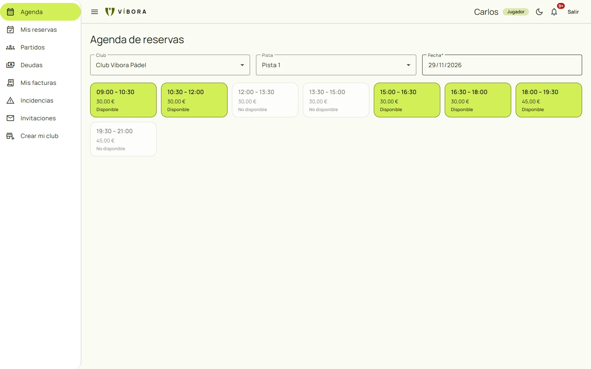
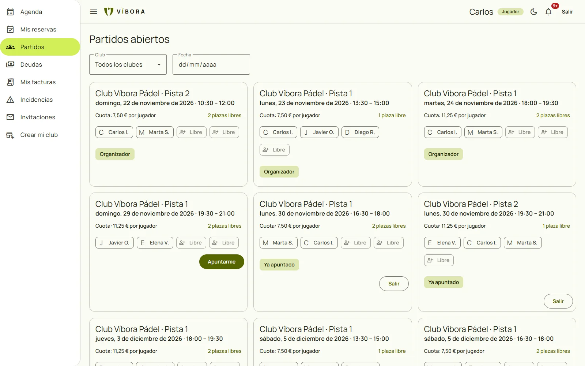
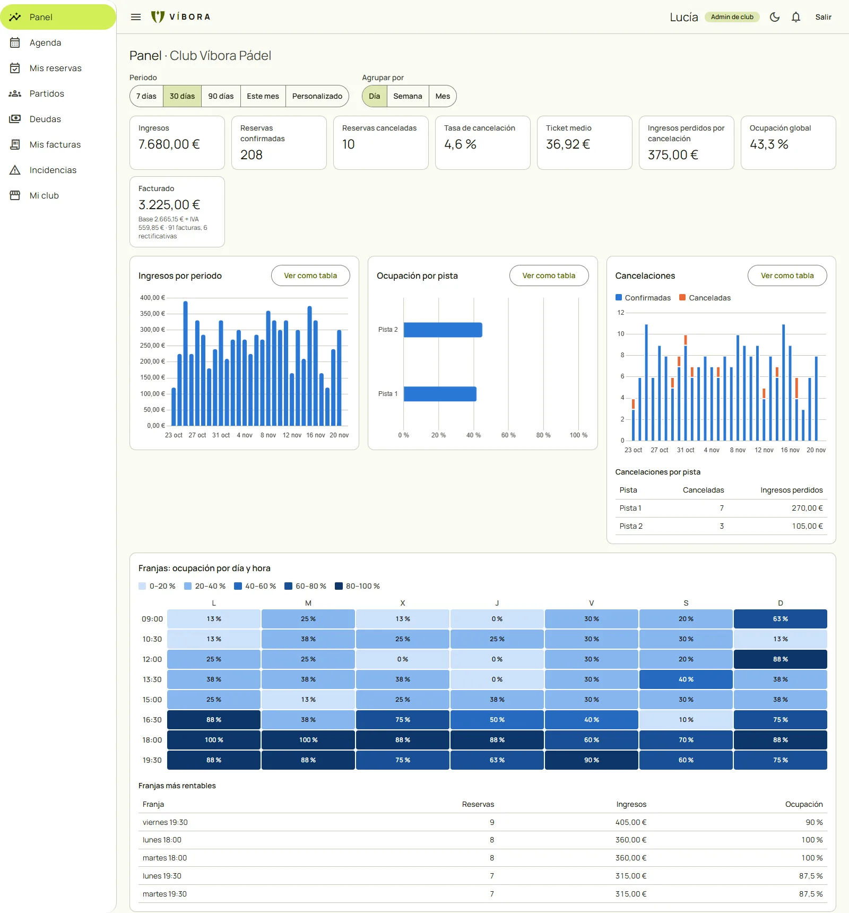
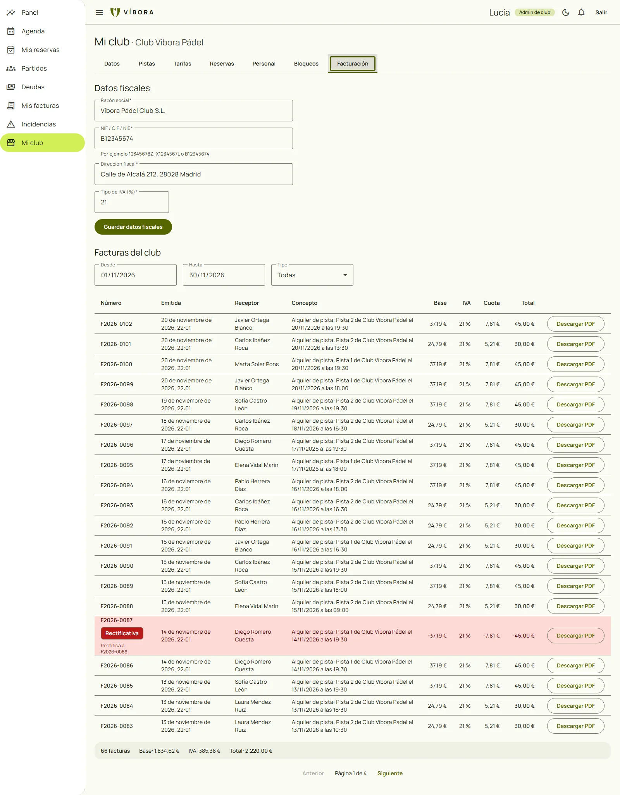
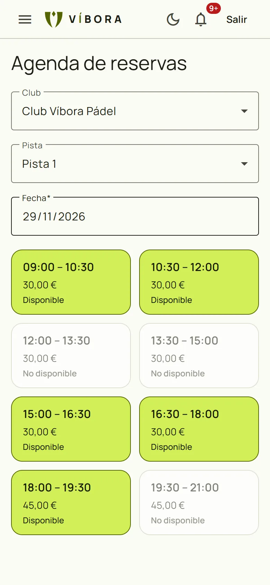
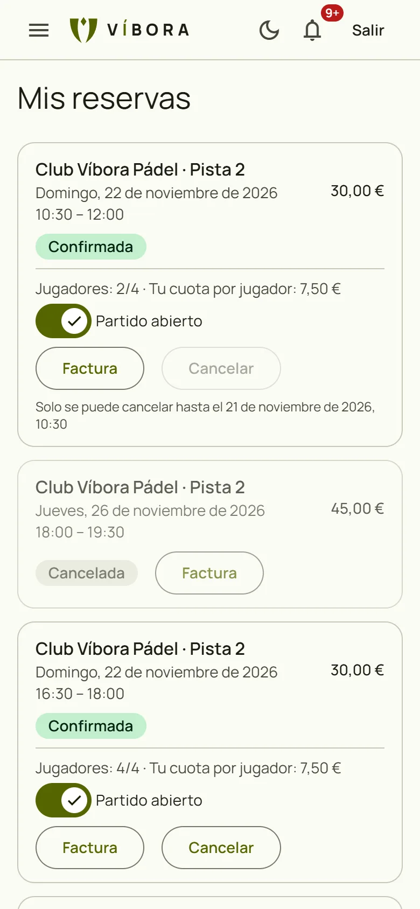
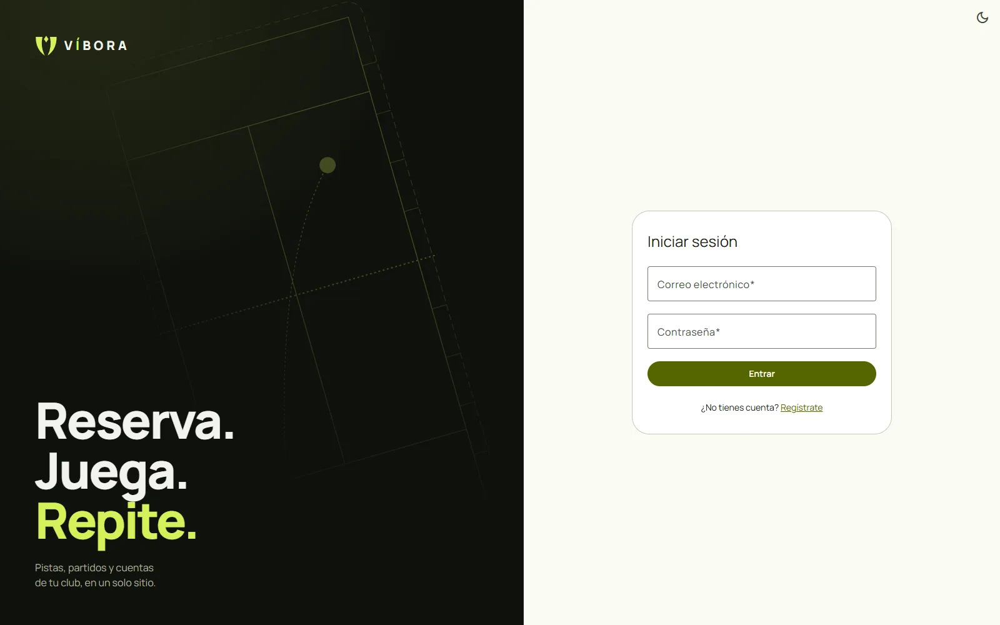
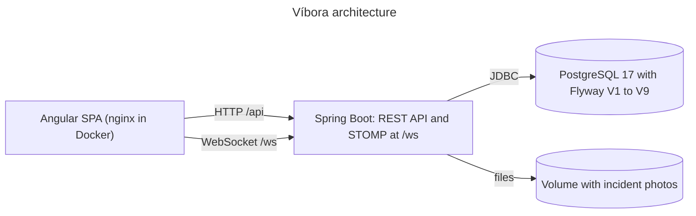
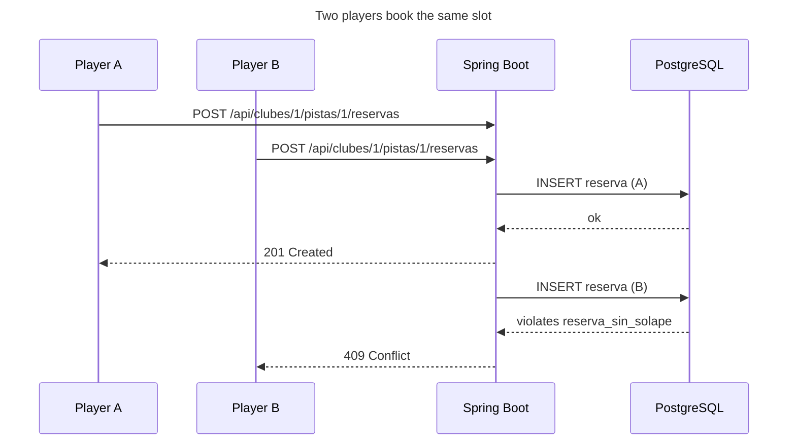

<a name="readme-top"></a>

<div align="center">

**English** · [Español](./README.es.md)

<picture>
  <source media="(prefers-color-scheme: dark)" srcset="./docs/assets/banner-dark.png">
  <source media="(prefers-color-scheme: light)" srcset="./docs/assets/banner-light.png">
  
</picture>

# Víbora

Padel club app that books courts without double bookings and helps players fill a match and split the fee.

<!-- Repo-based badges: the repository is private, so these do not render yet. Uncomment them when the repo goes public.
[](./LICENSE)
[](https://github.com/christianoller8/vibora/commits/main)
-->

**[Architecture](#architecture)** · [Security](#security) · [Getting started](#getting-started) · [Testing and verification](#testing-and-verification) · [Status and roadmap](#status-and-roadmap)

</div>

> [!NOTE]
> All data is synthetic: users are `@vibora.test` accounts and all money is simulated. No real payments, no real invoices.

## Demo

<!-- Demo video: not recorded yet. When it exists, upload it as described in the author's notes, then replace the URL below and uncomment the block.
https://github.com/user-attachments/assets/00000000-0000-0000-0000-000000000000
-->

<table>
  <tr>
    <td width="50%">
      <picture>
        <source media="(prefers-color-scheme: dark)" srcset="./docs/assets/agenda-dark.webp">
        <source media="(prefers-color-scheme: light)" srcset="./docs/assets/agenda-light.webp">
        
      </picture>
    </td>
    <td width="50%">
      <picture>
        <source media="(prefers-color-scheme: dark)" srcset="./docs/assets/partidos-dark.webp">
        <source media="(prefers-color-scheme: light)" srcset="./docs/assets/partidos-light.webp">
        
      </picture>
    </td>
  </tr>
  <tr>
    <td width="50%">
      <picture>
        <source media="(prefers-color-scheme: dark)" srcset="./docs/assets/panel-dark.webp">
        <source media="(prefers-color-scheme: light)" srcset="./docs/assets/panel-light.webp">
        
      </picture>
    </td>
    <td width="50%">
      <picture>
        <source media="(prefers-color-scheme: dark)" srcset="./docs/assets/facturacion-dark.webp">
        <source media="(prefers-color-scheme: light)" srcset="./docs/assets/facturacion-light.webp">
        
      </picture>
    </td>
  </tr>
  <tr>
    <td width="50%">
      <picture>
        <source media="(prefers-color-scheme: dark)" srcset="./docs/assets/mobile-agenda-dark.webp">
        <source media="(prefers-color-scheme: light)" srcset="./docs/assets/mobile-agenda-light.webp">
        
      </picture>
      <picture>
        <source media="(prefers-color-scheme: dark)" srcset="./docs/assets/mobile-reservas-dark.webp">
        <source media="(prefers-color-scheme: light)" srcset="./docs/assets/mobile-reservas-light.webp">
        
      </picture>
    </td>
    <td width="50%">
      <picture>
        <source media="(prefers-color-scheme: dark)" srcset="./docs/assets/login-dark.webp">
        <source media="(prefers-color-scheme: light)" srcset="./docs/assets/login-light.webp">
        
      </picture>
    </td>
  </tr>
</table>

The interface has a dark theme (default) and a light theme with a toggle. Contrast was checked against WCAG AA in both.

## About the project

Small padel clubs often run bookings over WhatsApp or spreadsheets, and players spend more time finding a fourth player and splitting the court fee than playing. Víbora gives each club a court schedule where **two bookings can never overlap**, and lets a player open a booking as a match that others join, with the fee split automatically.

### Key features

- **Bookings without overlaps**: two players booking the same slot at the same moment get one `201` and one `409`.
- **Open matches and shared fees**: up to 4 players per booking; the fee is split in cents and each player gets a charge to pay (simulated payment).
- **Live notifications**: a player who joins or leaves, a new charge or a cancelled booking arrive over WebSocket (STOMP) without reloading.
- **Incidents**: players who have played at the club, and its staff, report court problems with photos; the admin assigns them to maintenance and can block a court without touching bookings already made.
- **Club management**: tariffs per time band, courts, staff by invitation (the invited person accepts or declines), and the day's bookings with admin cancellation.
- **Invoices**: gapless numbering per club and year, VAT, corrective invoices and PDF. They are simulated documents without tax validity.
- **Metrics panel**: revenue, occupancy, best time bands and cancellations; it is the club admin's landing page (`/panel`).

### Scope and non-goals

| Status | Capability | Note |
| --- | --- | --- |
| Done and tested | Booking without overlaps under concurrency | `ReservaConcurrenciaTests` |
| Done and tested | Cap of 10 active bookings per player under concurrency | `ReservaCupoConcurrenciaTests` |
| Done | Open matches, fee split, simulated payments | Balances per player |
| Done | Invoices, club tax data, metrics panel | Screens in the club "Facturación" tab, player "Mis facturas" and `/panel` |
| Out of scope | Real payments | Payment is a state change in the database |
| Out of scope | Invoices with tax validity | Every PDF says "simulated document" |
| Out of scope | Sending emails | Invitations and alerts appear inside the app |
| Out of scope | Running several backend instances | Anti-abuse limits live in memory per instance |
| Out of scope | Native mobile app | The web app is responsive |
| Pending | Phase 4: AI matchmaking | Not started |

## Architecture



The Angular app calls the REST API and opens a STOMP WebSocket at `/ws`. In Docker, nginx serves the app and forwards `/api` and `/ws` to the backend, which is not published on the host. The backend stores data in PostgreSQL, whose schema is managed by Flyway migrations `V1` to `V9`, and keeps incident photos as files in a volume.

### Booking flow



Both requests arrive at the same time. PostgreSQL accepts the first insert and rejects the second one because it overlaps; the backend turns that violation into `409 Conflict`. The guarantee lives in the database, not in the Java code.

### Technical decisions

| Decision | Discarded alternative | Why, and what it costs |
| --- | --- | --- |
| "No overlapping bookings" is a PostgreSQL exclusion constraint (`btree_gist`, `reserva_sin_solape`) | Check for an overlap in Java, then insert | Two simultaneous requests cannot both pass a check-then-insert. Cost: the rule lives in SQL and the violation must be mapped to a `409` (the Java check remains only for a friendly error in the normal case) |
| Permissions are read from the database on every request | Put the staff role and club in the JWT | A staff member removed from the club loses access immediately, not when the token expires. Cost: one extra query per request. The token carries only the email and a coarse role claim that no endpoint trusts |
| Invoice numbers come from a counter row locked in the same transaction (`factura_serie`), and a trigger makes invoices immutable | Compute `max(numero) + 1`, or rely on the application to never edit | A rolled-back transaction rolls back the counter, so there are no gaps; a correction is a new corrective invoice. Cost: concurrent invoices of one club and year are serialized |

### Roles and permissions

Every check below is made against the database, not against the token.

| Role | Can do |
| --- | --- |
| `JUGADOR` (player) | Book courts, open and join matches, pay shares, see own bookings, invoices and balances; accept or decline staff invitations. Self-registration always creates this role |
| `MONITOR` | Club staff with no admin powers; can report incidents |
| `MANTENIMIENTO` (maintenance) | Works the incidents assigned to them and can list the court blocks of their club |
| `ADMIN_CLUB` (club admin) | Everything for their own club: courts, tariffs, staff invitations, court blocks, bookings, invoices, tax data, metrics |

### Metrics definitions

All defined in `vibora-backend/src/main/java/com/vibora/metricas/MetricasService.java`. A booking's day is the local date (Europe/Madrid) of its start, and no player data leaves these endpoints.

| Metric | Definition |
| --- | --- |
| Revenue | Sum of the frozen price of `CONFIRMADA` bookings per play day. It is not what was collected or invoiced |
| Lost revenue | Same sum over cancelled bookings |
| Occupancy | Occupied slots divided by offered slots, using the current opening hours and courts for the whole range |
| Cancellation rate | Cancelled bookings divided by confirmed plus cancelled |
| Average ticket | Revenue divided by confirmed bookings (empty if there are none) |
| Best time bands | Weekday and start time ranked by revenue, then by number of bookings |
| Invoiced | Invoices issued in the range, net of corrective invoices (which carry negative amounts) |

<details>
<summary><strong>Main endpoints</strong></summary>

Everything except registration, login, token refresh, single sign-out and `/actuator/health` needs the `Authorization: Bearer <token>` header.

| Method and path | Purpose |
| --- | --- |
| `POST /api/auth/registro`, `POST /api/auth/login`, `GET /api/auth/me` | Register, sign in, current profile |
| `POST /api/auth/refrescar`, `POST /api/auth/cerrar-sesion`, `POST /api/auth/cerrar-sesion-todas` | Rotate the refresh cookie for a new access token, sign out this session, sign out everywhere |
| `GET /api/clubes`, `POST /api/clubes`, `PUT /api/clubes/{id}` | Clubs |
| `GET\|POST /api/clubes/{clubId}/pistas`, `.../tarifas` | Courts and tariffs |
| `GET /api/clubes/{clubId}/pistas/{pistaId}/agenda?fecha=` | Daily schedule of a court |
| `POST /api/clubes/{clubId}/pistas/{pistaId}/reservas` | Book a slot (`201`, or `409` if taken) |
| `GET /api/reservas/mias`, `POST /api/reservas/{id}/cancelar` | Own bookings, cancel |
| `GET /api/partidos`, `PUT /api/reservas/{id}/abierta`, `POST /api/reservas/{id}/apuntarse`, `.../salir` | Open matches |
| `GET /api/cargos/mios`, `POST /api/cargos/{id}/pagar`, `GET /api/saldos` | Charges, simulated payment, balances |
| `POST /api/clubes/{clubId}/incidencias`, `POST /api/incidencias/{id}/fotos` | Incidents and photos |
| `POST /api/clubes/{clubId}/invitaciones`, `POST /api/invitaciones/{id}/aceptar` | Staff invitations |
| `POST /api/reservas/{id}/factura`, `GET /api/facturas/{id}/pdf` | Issue an invoice, download its PDF |
| `GET /api/clubes/{clubId}/metricas/resumen\|ingresos\|ocupacion\|franjas\|cancelaciones` | Club metrics |
| `GET /api/notificaciones`, WebSocket `/ws` | Notifications |

**API docs (Swagger UI).** `./mvnw spring-boot:run` turns them on (the Maven plugin sets `VIBORA_API_DOCS=true`):

1. Open `http://localhost:8081/swagger-ui/index.html` (the spec is at `http://localhost:8081/v3/api-docs`).
2. Log in with `POST /api/auth/login` and paste the JWT into **Authorize**.

Everywhere else they are off and the backend answers 404: `java -jar`, runs from the IDE and the Docker image. To turn them on there, set `VIBORA_API_DOCS=true` (for the image, `docker run -e VIBORA_API_DOCS=true`; `docker-compose.yml` does not pass it through). Keep it to local work: it publishes the whole API spec without asking for a token.

</details>

<details>
<summary><strong>Project structure</strong></summary>

| Path | Responsibility |
| --- | --- |
| `vibora-backend/` | Spring Boot API, domain packages (`reserva`, `partido`, `cargo`, `factura`, `metricas`, ...) and Flyway migrations |
| `vibora-frontend/` | Angular app, nginx config and the CSP generator (`docker/csp.mjs`) |
| `scripts/` | `seed-dev.mjs`, the sample data script (dev only) |
| `ops/` | `db-roles.sql` and `backup-dev.mjs` |
| `docker-compose.yml` | PostgreSQL, and backend plus frontend under the `app` profile |
| `.github/workflows/ci.yml` | CI definition (see the status section) |
| `docs/assets/` | Banner and screenshots |

</details>

## Tech stack

| Layer | Technology | Purpose |
| --- | --- | --- |
| Frontend |   | Single-page app and UI components |
| Frontend |   | Metrics charts and live notifications |
| Backend |   | REST API, WebSocket, security, booking rules |
| Data |   | Storage, exclusion constraint, migrations |
| Testing |   | Integration tests on real PostgreSQL, frontend tests |
| Delivery |   | Full stack in containers |

## Security

- **Passwords**: hashed with BCrypt, normalized to Unicode NFC, and limited to 72 UTF-8 bytes (BCrypt would otherwise truncate silently). Login always checks a hash, even for unknown emails, so response time does not reveal which accounts exist.
- **Session**: a stateless JWT signed with HMAC-SHA256 (`sub` = email, 15 minutes). The secret must be at least 32 bytes; the app refuses to start otherwise.
- **Refresh and revocation**: login also sets a refresh token in an `HttpOnly`, `Secure`, `SameSite=Strict` cookie scoped to `/api/auth` (14 days sliding, 30 days absolute; only its SHA-256 is stored). Every use rotates it, and reusing an already rotated token revokes the whole token family, so a stolen copy stops working. Rotation is strict, with no grace window: the client must serialize its refreshes, and retrying with an already rotated token (for example after a lost response) ends the session on purpose. If a refresh response is lost (timeout, closed tab or reload mid-request), the next refresh reuses the old cookie and the session ends on purpose, so you sign in again. Each user has a session version that every access token carries (`ver`) and every request checks, so "sign out everywhere" invalidates access tokens immediately and closes that user's open WebSockets. With a hung backend, startup waits about 30 s at worst before the app falls back to anonymous.
- **Authorization**: club membership and role are read from the database on every request (see the decisions table). Self-registration can only create players.
- **Rate limits**: login is limited per IP and email, registration per IP, and token refresh per IP (only FAILED refreshes count; a successful rotation does not, and neither do requests without a cookie; a full bucket answers `429` to any refresh from that IP, even with a valid cookie); exceeding a limit returns `429` with `Retry-After`. A `429` on refresh means "retry later", not "session ended": the client does not drop the session on it. The client sends a single refresh at a time: one shared request per tab, and, where the browser supports Web Locks, a lock (`vibora-refresco`) across tabs, because the backend treats two concurrent refreshes with the same cookie as theft. It also refreshes about 60 seconds before the access token expires to keep the WebSocket alive. nginx adds its own limit on login and registration.
- **Browser policy**: the Content-Security-Policy is generated by `vibora-frontend/docker/csp.mjs` with no `unsafe-inline` for scripts (inline scripts are allowed only by hash), and `npm run test:csp` checks it.
- **Database roles**: `ops/db-roles.sql` defines least-privilege roles for production.
- **Known limits**: the access token lives only in memory and lasts 15 minutes; the refresh token is an `HttpOnly` cookie. An XSS flaw in an open page can still act there and even call the refresh endpoint while the page is open, but it cannot read the refresh token or take a long-lived credential away; the strict CSP is the mitigation. `cerrar-sesion` closes only that session's refresh token: its current access token stays valid until it expires (up to 15 minutes) and open WebSockets stay connected; "sign out everywhere" invalidates access tokens at once.

<details>
<summary><strong>Limits and protections (all values)</strong></summary>

Every value is a property in `application.properties` and can be overridden with an environment variable. Exceeding a rate limit returns **429** with `{"error": "..."}` and a `Retry-After` header (seconds).

| What | Property | Default |
| --- | --- | --- |
| Login attempts per (IP, email) | `vibora.seguridad.login-max-por-email` / `login-ventana` | 5 per 15 min (a successful login resets the counter) |
| Login attempts per IP | `vibora.seguridad.login-max-por-ip` | 30 per 15 min |
| Registrations per IP | `vibora.seguridad.registro-max-por-ip` / `registro-ventana` | 10 per hour |
| Failed token refreshes per IP | `vibora.seguridad.refresco-max-por-ip` / `refresco-ventana` | 60 per 15 min |
| Refresh token life | `vibora.sesion.refresco-dias` / `maximo-dias` | 14 days sliding, 30 days absolute from login |
| Booking horizon | `vibora.reservas.horizonte-dias` | 60 days (Madrid calendar day) → 400 |
| Active bookings per player | `vibora.reservas.max-activas-por-usuario` | 10 (confirmed and not started) → 409; joining an open match does not count |
| Simultaneous image decodes | `vibora.almacen.decodificaciones-simultaneas` / `espera-decodificacion` | 2; no free slot within 10 s → 503 |
| Maximum photo resolution | `vibora.almacen.max-megapixeles` | 16 MP |
| Photos per person | `vibora.almacen.cuota-diaria-por-usuario` | 40 in a rolling 24 h → 429 |
| Orphan temporary files | `vibora.almacen.limpieza-tmp-horas` / `limpieza-tmp-cron` | `tmp-*` older than 1 h are deleted hourly |
| WebSocket sessions per person | `vibora.websocket.max-sesiones-por-usuario` | 10 (the next one gets an ERROR frame) |
| Pending staff invitations per club | `vibora.personal.max-pendientes-por-club` | 50 → 429 |
| Staff invitations created per club in 24 h | `vibora.personal.max-invitaciones-por-club-24h` | 30 → 429 |

nginx also limits `/api/auth/login` (10 requests per minute, burst 5) and `/api/auth/registro` (5 per minute, burst 3) per IP, with a JSON `429`.

The photo quota counts the photos that exist in the last 24 hours, so uploading, deleting and uploading again frees quota on purpose.

**IP limits and topology.** The per-IP limits only tell clients apart if nginx sees their real IP. With Docker Desktop's NAT, a shared Wi-Fi or a load balancer, every client can arrive with the same IP and share one bucket. Two options:

- **Real IP in nginx** (off by default): mount a `*.conf` file at `/etc/nginx/realip/` in the `frontend` container with your trusted proxy range (never `0.0.0.0/0` in production):

  ```nginx
  set_real_ip_from 10.0.0.0/8;
  real_ip_header X-Forwarded-For;
  real_ip_recursive on;
  ```

  In Compose: `volumes: ["./ops/realip.conf:/etc/nginx/realip/realip.conf:ro"]` on the `frontend` service.
- **Raise the thresholds** where IPs cannot be told apart (demos, shared networks): `VIBORA_SEGURIDAD_LOGIN_MAX_POR_IP`, `VIBORA_SEGURIDAD_REGISTRO_MAX_POR_IP`, and the `rate=`/`burst=` of the `auth_login` and `auth_registro` nginx zones.

IPv6 addresses are grouped by /64. **The login and registration limiter is in memory and per instance**: with more than one backend instance each counts separately. It would have to move to Redis or similar.

</details>

<details>
<summary><strong>Staff invitations</strong></summary>

Nobody becomes a monitor or maintenance worker without accepting. The club admin invites an email address and the person decides:

1. `POST /api/clubes/{clubId}/invitaciones` with `{email, rol}` (`MONITOR` or `MANTENIMIENTO`; club admin only) always answers `202` with the same message, whether the email is registered, free, already in another club or unknown. There is no account enumeration. The only visible errors are `400`, `403`/`404` and `429`. Inviting the same email twice while the first invitation is alive does nothing new.
2. `GET /api/clubes/{clubId}/invitaciones?estado=` lists the club's invitations (newest first, up to 100) and `DELETE /api/clubes/{clubId}/invitaciones/{id}` cancels a pending one.
3. The invited person sees `GET /api/invitaciones/mias` and decides with `POST /api/invitaciones/{id}/aceptar` or `.../rechazar`. Only the recipient, identified by the email stored in the database and not by the token, can do it; anyone else gets `404`. After accepting, the person must sign in again because the old token still says `JUGADOR`.
4. Staff can leave with `POST /api/personal/salir`. The admin removes staff with `DELETE /api/clubes/{clubId}/personal/{usuarioId}`. Either way the person goes back to `JUGADOR` and their active incidents stay open and unassigned.

An invitation expires after 14 days (`vibora.personal.invitacion-dias`); a daily job (03:45 Madrid time) marks expired ones. Caps per club: 50 pending and 30 created per 24 hours.

</details>

<details>
<summary><strong>Incident photos</strong></summary>

Photos (JPEG, PNG or WebP, up to 5 MB and 4 per incident) are stored as files, not in the database, in the folder `vibora.almacen.directorio`:

- **Local development**: `./data/uploads`, relative to where you start the backend (`vibora-backend/data/uploads` with `./mvnw spring-boot:run`). It is created automatically and git-ignored.
- **Docker**: the `backend` service mounts the named volume `vibora-uploads` at `/data/uploads`. It survives `docker compose --profile app up -d --build`; only `down -v` deletes it. To copy it out: `docker run --rm -v vibora_vibora-uploads:/datos -v "$PWD":/copia alpine tar czf /copia/uploads.tgz -C /datos .`

Photos are re-encoded on upload, so EXIF and GPS data are lost (WebP files are stored as they are, with their metadata). They are downloaded with `GET /api/incidencias/{id}/fotos/{fotoId}`, which requires the JWT: an `` cannot send the `Authorization` header, so the frontend fetches them with `HttpClient` as a blob. The frontend nginx must allow bodies of at least 6 MB on `/api` (`client_max_body_size 6m;`).

</details>

<details>
<summary><strong>Database roles for production</strong></summary>

In development the app uses the container's `vibora` superuser. For production, `ops/db-roles.sql` (it does not run by itself) creates three roles: `vibora_owner` (schema owner, used by Flyway), `vibora_app` (the application: `SELECT/INSERT/UPDATE/DELETE`, no DDL, no `TRUNCATE`, and only `SELECT` and `INSERT` on `factura`) and `vibora_ro` (read only).

1. As a superuser (idempotent): `psql -U postgres -d vibora -v ON_ERROR_STOP=1 -f ops/db-roles.sql`. On a **new database** run it **twice**: once before the first migration and again after the first successful migration, because `factura` and `flyway_schema_history` do not exist on the first pass and their `REVOKE` cannot be applied. Run it again after any migration that creates immutable tables.
2. Set passwords (the script stores no secrets): `ALTER ROLE vibora_app PASSWORD '...';` and the same for `vibora_owner` and `vibora_ro`.
3. Start the app with one connection per purpose:

   ```env
   SPRING_DATASOURCE_USERNAME=vibora_app
   SPRING_DATASOURCE_PASSWORD=...
   SPRING_FLYWAY_USER=vibora_owner
   SPRING_FLYWAY_PASSWORD=...
   ```

A future migration that creates another immutable table must include its own `REVOKE UPDATE, DELETE ... FROM vibora_app`. `RolesBdTest` runs the real script against a test PostgreSQL and checks all of this. Migration `V7` adds constraints (case-insensitive unique emails, club opening hours, non-overlapping tariff bands) and fails with a clear message, applying nothing, if existing data violates them.

Development backup: `node ops/backup-dev.mjs [--out <folder>]` (default `./backups`) writes `vibora-<date>.sql.gz` and, if the volume exists, `vibora-uploads-<date>.tar.gz`. Restore commands are in the script header.

</details>

## Getting started

### Prerequisites

- JDK 25
- Node.js 24 (the version CI uses; the seed script needs Node 20 or later)
- Docker Desktop (the database and the backend tests use containers)

### Run in development

```bash
docker compose up -d db                      # PostgreSQL on 127.0.0.1:15433
cd vibora-backend && ./mvnw spring-boot:run  # API at http://localhost:8081
cd vibora-frontend && npm ci && npm start    # app at http://localhost:4200
```

Run each of the last two commands in its own terminal. Then load the sample data with the backend running:

```bash
node scripts/seed-dev.mjs
```

Open <http://localhost:4200> and sign in as `jugador1@vibora.test` (a player with no privileges) with the password `Vibora-dev-2026`. The seed also creates `admin@vibora.test` (club admin) and `jugador2@vibora.test` to `jugador4@vibora.test`.

> [!WARNING]
> The seed users and their password are for development only. The script creates accounts with a known password and refuses to run against any host other than `localhost`, `127.0.0.1` or `[::1]`. Never use it in a shared or production environment.

The seed is idempotent. It creates "Club Vibora Demo" (09:00 to 21:00) with two courts, tariffs for every day and an open match three days ahead at 18:00 Madrid time with 2 free spots.

<details>
<summary><strong>Windows: port forbidden by the system</strong></summary>

If Docker fails with `bind: An attempt was made to access a socket in a way forbidden by its access permissions`, the host port falls in a range reserved by Windows (check with `netsh interface ipv4 show excludedportrange protocol=tcp`; it changes after a reboot). Pick another port with `POSTGRES_PORT` (Compose) and the same value in `VIBORA_DB_PORT` (backend).

If Maven fails with a certificate error (PKIX) behind an antivirus, export `MAVEN_OPTS="-Djavax.net.ssl.trustStoreType=Windows-ROOT"` first.

</details>

### Run the full stack with Docker

Database, backend and frontend (nginx) run in containers. The last two live under the `app` profile, so `docker compose up -d db` still starts only PostgreSQL.

```bash
cp .env.example .env       # then edit .env and set your own VIBORA_JWT_SECRET (the file explains how to generate one)
docker compose --profile app up -d --build
```

The web app is at <http://localhost:8088> (change the port with `FRONTEND_PORT` in `.env`). The sample data script also works against this stack: `node scripts/seed-dev.mjs --base-url http://localhost:8088`.

`VIBORA_JWT_SECRET` is mandatory. A check service (`comprobar-VIBORA_JWT_SECRET`, only with the `app` profile) runs before the backend and aborts `up` immediately if the secret is empty, shorter than 32 characters or still the `CAMBIAME-...` placeholder from `.env.example`:

```text
service "comprobar-VIBORA_JWT_SECRET" didn't complete successfully: exit 1
```

Run `docker compose --profile app logs comprobar-VIBORA_JWT_SECRET` for the exact reason. To stop only the app and keep the database running:

```bash
docker compose --profile app stop backend frontend
docker compose --profile app up -d --build
```

**Careful:** `docker compose down -v` deletes the `vibora-pgdata` volume (the database) and `vibora-uploads` (incident photos).

If you started the app with `--no-deps backend frontend` and later stopped the backend, restart it with `docker start vibora-backend-1`: `docker compose start backend` fails because the check service was never created.

### Environment variables

Defined in `docker-compose.yml` and `application.properties` (`VIBORA_API_DOCS` only in `application.properties`, the `pom.xml` and the backend `Dockerfile`). `.env.example` explains how to generate a secret.

| Variable | Required | Default | Description |
| --- | :---: | --- | --- |
| `VIBORA_JWT_SECRET` | Yes (Docker) | none | HMAC secret for tokens, at least 32 bytes. Outside Docker a public development secret is used: never deploy with it |
| `POSTGRES_PORT` | No | `15433` | Host port of PostgreSQL (127.0.0.1 only) |
| `VIBORA_DB_PORT` | No | `15433` | Port the backend connects to in local development; match `POSTGRES_PORT` |
| `POSTGRES_DB`, `POSTGRES_USER`, `POSTGRES_PASSWORD` | No | `vibora` | Database name and credentials (development defaults) |
| `FRONTEND_PORT` | No | `8088` | Host port of the full Docker stack |
| `VIBORA_WEBSOCKET_ORIGENES_PERMITIDOS` | No | `http://localhost:8088` in Docker, `http://localhost:4200` locally | Browser origins allowed to open the WebSocket |
| `VIBORA_ALMACEN_DIRECTORIO` | No | `/data/uploads` in Docker, `./data/uploads` locally | Folder for incident photos |
| `VIBORA_API_DOCS` | No | `false`; `./mvnw spring-boot:run` sets `true` | Serves the OpenAPI spec and Swagger UI; with `false` both answer 404 |
| `VIBORA_SESION_COOKIE_SEGURA` | No | `true` | `Secure` attribute of the refresh cookie. Keep `true` with HTTPS. Chrome and Firefox accept `Secure` cookies on `http://localhost`, but Safari does not, so set `false` for plain-HTTP use there |
| `JAVA_OPTS` | No | empty | Extra JVM options in Docker |

## Testing and verification

```bash
cd vibora-backend && ./mvnw test                  # needs Docker (Testcontainers); 1,410 tests as of November 2026
cd vibora-frontend && npx ng test --watch=false   # Vitest; 1,646 tests
cd vibora-frontend && npm run test:csp            # checks the generated CSP
cd vibora-frontend && npm run test:tema           # checks the initial theme script
cd vibora-frontend && npm run test:marca          # checks icons, theme-color and logo animation
cd vibora-frontend && npm run test:colores        # no literal colours outside the theme tokens
cd vibora-frontend && npm run test:paleta         # checks theme values and contrast of both themes
node --test "scripts/lib/*.test.mjs"              # date helper of the seed script
```

The backend suite takes several minutes because it starts a real PostgreSQL container.

1. **Main case**: sign in as `jugador1@vibora.test`, open the agenda and book a free slot → the booking appears under "Mis reservas" and the slot shows as taken.
2. **Edge case**: eight players book the same slot at the same instant → exactly one `201` and seven `409`. [`ReservaConcurrenciaTests`](./vibora-backend/src/test/java/com/vibora/reserva/ReservaConcurrenciaTests.java) logs in eight users, releases eight threads together with a barrier, repeats this five times and also checks that only one confirmed booking exists afterwards. [`ReservaCupoConcurrenciaTests`](./vibora-backend/src/test/java/com/vibora/reserva/ReservaCupoConcurrenciaTests.java) does the same for the cap of active bookings: fifteen simultaneous bookings of different slots with a cap of ten give 10 created and 5 conflicts.

## Status and roadmap

**Status:** active, in development.

CI is defined in [`.github/workflows/ci.yml`](./.github/workflows/ci.yml) (backend tests, frontend tests and guards, seed script tests, and a Docker smoke test through nginx), but it has never run on GitHub: the account has a billing lock that prevents jobs from starting. The commands it uses have been run locally.

- [ ] Phase 4: AI matchmaking
- [x] Frontend: use the refresh cookie and keep the access token in memory
- [ ] Anti-abuse limits shared between instances (for example in Redis)
- [ ] Run CI on GitHub

## Credits

Typography: [Manrope](https://fontsource.org/fonts/manrope) (self-hosted, SIL Open Font License). Icons: Material Symbols from Google Fonts. The Víbora logo is original.

## Author

Built by **Christian Oller**. The idea, the domain design and the decisions are mine; the code was written with AI coding agents that I directed, reviewed and verified.

[GitHub](https://github.com/christianoller8)

## License

Distributed under the MIT License. See [LICENSE](./LICENSE).

<p align="right"><a href="#readme-top">Back to top</a></p>
